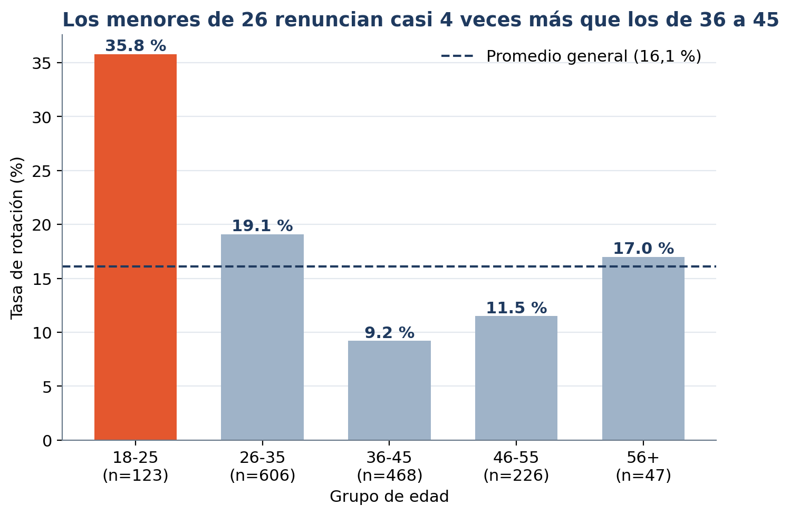
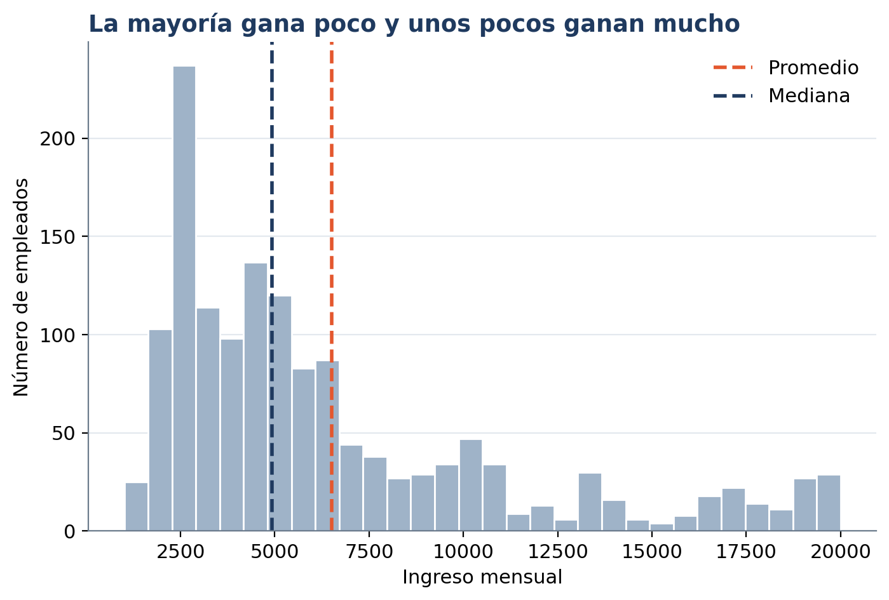

# analisis-rotacion-empleados
Análisis exploratorio de rotación de empleados con Python y pandas
# Rotación de empleados: ¿quién renuncia?

Análisis exploratorio del dataset IBM HR Analytics Employee Attrition con Python.

## Pregunta
¿Qué grupos de empleados tienen mayor tasa de rotación?

## Datos
1.470 empleados y 35 variables. Fuente: PEGA_AQUÍ_EL_ENLACE_DE_KAGGLE   ←

## Proceso
- Extracción, limpieza y análisis con Python (pandas) en Google Colab
- Eliminé 3 columnas constantes y usé EmployeeNumber como índice
- Creé la variable Attrition_flag y grupos de edad

## Hallazgos
- Rotación general: 16,1 %
- Los menores de 26 años renuncian a una tasa de 35,8 %, casi 4 veces la del grupo de 36 a 45 (9,2 %)
- El sueldo mediano (4.919) es menor que el promedio (6.503): unos pocos sueldos altos lo jalan hacia arriba

## Límites
- El grupo de 56+ tiene solo 47 personas, así que su tasa es poco fiable
- Los datos muestran asociaciones, no causas
- Es un dataset de práctica, no datos reales de una empresa

## Cómo reproducirlo
1. Descarga el dataset desde el enlace de arriba y renómbralo a Dataset1.csv
2. Abre el cuaderno en Google Colab y sube el CSV
3. Ejecuta todas las celdas

## Herramientas
Python, pandas, matplotlib
Carlos Mercado  · LinkedIn:(https://www.linkedin.com/in/carlos-mercadoa/)
